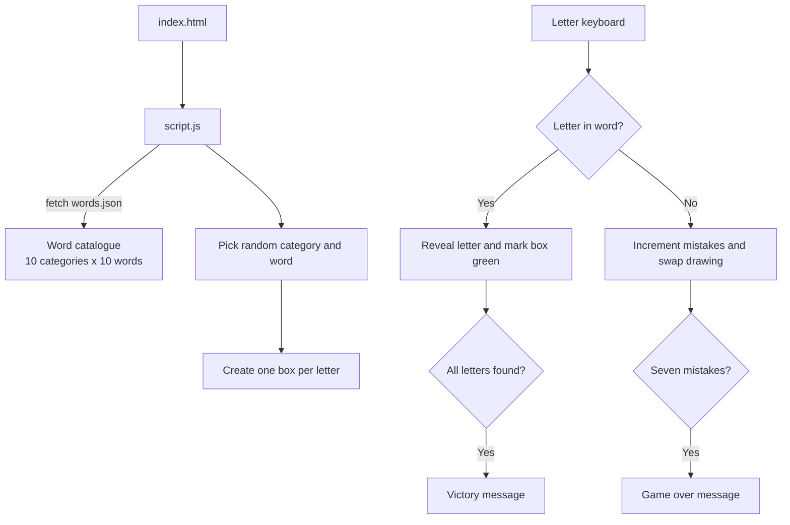
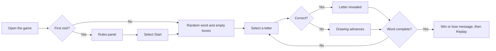

<div align="center">


<p><strong>A word-guessing game with a virtual keyboard, seven allowed mistakes, and a drawing that fills in with each wrong letter.</strong></p>

</div>

<div align="center">

<a href="https://github.com/mohammed-laabidi/hangman-game"></a>
<a href="https://github.com/mohammed-laabidi/hangman-game/fork"></a>
<a href="https://github.com/mohammed-laabidi/hangman-game/issues"></a>


</div>

<div align="center">

<a href="https://mohammed-laabidi.github.io/hangman-game/"><strong>Live Demo</strong></a>
&nbsp;&nbsp;|&nbsp;&nbsp;
<a href="https://github.com/mohammed-laabidi/hangman-game">Repository</a>

</div>

## Overview

Hangman is a browser implementation of the classic word game. A word is drawn at random from a local catalogue organised by category, and the player reveals it one letter at a time using an on-screen keyboard. Each incorrect letter adds a stage to the hangman drawing and increases the mistake counter; the seventh mistake ends the round.

The word list lives in `words.json`, which holds ten categories of ten words each, covering topics such as computers, fashion, sports, electronics, automotive, beauty, toys, books, and animals. The game reads this file with `fetch`, so it runs from a web server or from the GitHub Pages deployment.

The interface keeps a first-visit introduction in `localStorage`, so returning visitors go straight to the board.

## Features

<table>
<tr>
<td width="50%" valign="top">


### On-screen keyboard

Twenty-six letter buttons check the guess and mark used letters in red when they are not part of the word.

</td>
<td width="50%" valign="top">


### Categorised word bank

`words.json` provides ten categories with ten words each, and the category name is displayed above the board as a hint.

</td>
</tr>
<tr>
<td width="50%" valign="top">


### Progressive drawing

Seven images in `hangman photos/` are swapped in one by one as mistakes accumulate, showing the gallows, head, and body.

</td>
<td width="50%" valign="top">


### Mistake counter

The header reports the current score as `incorrect guesses: n/7` and the round ends at the seventh error.

</td>
</tr>
<tr>
<td width="50%" valign="top">


### Win and lose messages

When every letter is found the board shows a success message; when the attempts run out it shows a consolation message with a replay action.

</td>
<td width="50%" valign="top">


### First-visit introduction

The rules panel is shown only once per browser; a `localStorage` flag skips it on later visits.

</td>
</tr>
</table>

## Technology Stack

<div align="center">


</div>

| Technology | Purpose |
| --- | --- |
| HTML5 | Intro panel, board, and keyboard markup |
| CSS3 | Board layout, letter boxes, and two responsive breakpoints |
| JavaScript | Word selection, letter checks, drawing, and counters |
| JSON | Word catalogue stored in `words.json` |
| Fetch API | Loading the word catalogue at page start |
| Web Storage API | `localStorage` flag for the first-visit introduction |
| GitHub Pages | Static hosting of the live demo |

## Architecture

The game runs entirely in the browser. The only external resource is the local JSON catalogue, loaded once when the page starts.



## Application Flow



## Project Structure

```text
hangman-game/
├── index.html
├── style.css
├── script.js
├── words.json
├── hangman photos/
│   ├── status1.png
│   ├── status2.png
│   ├── status3.png
│   ├── status4.png
│   ├── status5.png
│   ├── status6.png
│   └── status7.png
└── README.md
```

## Getting Started

### Prerequisites

A modern browser. Because the game fetches `words.json`, it must be served over HTTP rather than opened as a local file.

### Installation

```bash
git clone https://github.com/mohammed-laabidi/hangman-game.git
cd hangman-game
python -m http.server 8000
```

Open `http://localhost:8000` in a browser.

## Usage

1. Read the introduction and select Start.
2. Read the category hint displayed above the board, then choose a letter.
3. Correct letters turn green and fill their boxes; wrong letters turn red and advance the drawing.
4. Reveal the whole word to win, or reach seven mistakes to lose.
5. Use Replay to reload the page with a new word, or Exit to close the tab.

Words are stored without spaces during the round, and the letter check replaces each found letter so a box is never filled twice.

## Deployment

The live demo is hosted on GitHub Pages from the repository root. The deployment serves `words.json` alongside the page, which is required for the game to start.

## Author

<table>
<tr>
<td valign="top">

**Mohammed Laabidi**

<a href="https://github.com/mohammed-laabidi"> GitHub</a>
&nbsp;&nbsp;
<a href="https://www.linkedin.com/in/mohammed-laabidi-793a40436"> LinkedIn</a>
&nbsp;&nbsp;
<a href="mailto:mohammed-laabidi@gmail.com"> Email</a>

</td>
</tr>
</table>

---

If this project is useful to you, consider giving the repository a star.
